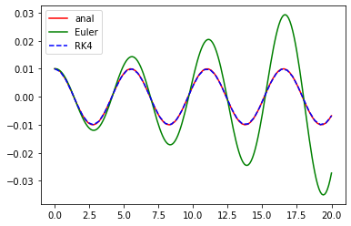

# The sinking of the Vasa

Group project (three of us) in TMA4320 at NTNU, spring 2022. We model a ship as a semicircular
hull in 2D and simulate how it rolls and capsizes. The notebook is in Norwegian.

We start with just gravity and buoyancy and compare Euler's method and RK4 against the analytical
small-angle solution. Euler's method slowly adds energy, so the amplitude grows, while RK4 stays on top
of the exact curve:

After that the model gets more realistic step by step:

- the displaced water varies as the ship rolls and heaves
- cargo that slides on the deck, with and without fences
- friction and a harmonic wave force

The last part is a made-up scenario about the Swedish warship Vasa (1628): the ship is moored
tilted at the quay, the rope is cut, and we find how heavy a load on the opposite edge has to be
to tip it over on the first swing. RK4 gives 7452 kg and Euler-Cromer 7461 kg per metre of hull.

Runs with numpy, scipy and matplotlib, no data files needed. Some of the parameter sweeps are slow.
